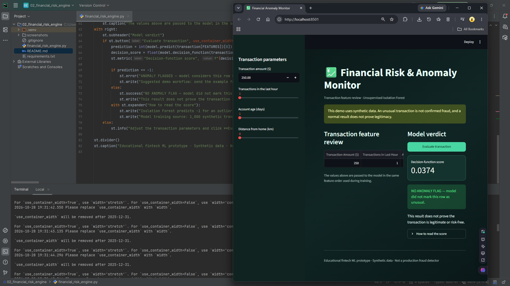

# Financial Risk & Fraud Anomaly Detection Engine

**Junior Machine Learning Portfolio Project 02/06**  
**Author:** Moe Htet Ar Kar (Phoe Cho)

An interactive anomaly-detection dashboard that scores a transaction using an Isolation Forest trained on generated transaction patterns.

> **Scope:** A learning and portfolio application built with a small, understandable Python script. It is not a production or safety-critical system.

## Dashboard Design




## What the project demonstrates

- Building an interactive user interface with Streamlit.
- Preparing input features in a consistent order and passing them to a scikit-learn model.
- Training and caching a model to avoid retraining on every Streamlit rerun.
- Presenting model output and interpreting it with appropriate caveats.
- Organizing a small Python project with isolated dependencies and Git hygiene.

## Model and data

**Model / workflow:** IsolationForest with contamination=0.05; unsupervised outlier detection.

**Training data:** 1,000 generated examples using exponential transaction amounts and geographic distances, Poisson transaction velocity, and generated account age.

## Output design

A dark green fintech dashboard showing the entered transaction row, the anomaly verdict, the decision-function score, and a plain-language explanation of whether the generated model flags that row as unusual.

The live application is designed to show the entered features, the model output, and an explanation of what the result means. A prediction is only as reliable as its data, labels, features, and evaluation method.

## Technology stack

- Python 3.11
- Streamlit
- pandas / NumPy where used by this project
- scikit-learn
- TensorFlow/Keras where required by this project

## Run locally

### 1. Prerequisite

Install **64-bit Python 3.11**. Confirm it is available in your terminal:

```bash
python --version
```

On Windows, if the `python` command points to another interpreter, use `py -3.11` in place of `python` when creating the environment.

### 2. Create and activate a virtual environment

**Windows PowerShell**

```powershell
py -3.11 -m venv .venv
.\.venv\Scripts\Activate.ps1
python -m pip install --upgrade pip
```

**macOS / Linux**

```bash
python3.11 -m venv .venv
source .venv/bin/activate
python -m pip install --upgrade pip
```

### 3. Install dependencies

```bash
python -m pip install -r requirements.txt
```

### 4. Start the application

Run this command from the same folder as `requirements.txt`:

```bash
streamlit run financial_risk_engine.py
```

Streamlit prints a local URL in the terminal (normally `http://localhost:8501`). Open that address in your browser. To stop the app, press `Ctrl+C` in the terminal.

## Project folder structure

```text
02_financial_risk_engine/
├── .venv/
├── financial_risk_engine.py
├── requirements.txt
├── README.md
├── .gitignore
└── screenshots/
    └── output,png
```

## Current limitations

The model has no verified fraud labels and is not trained on real banking transactions. Isolation Forest identifies unusual feature combinations, not confirmed fraud. The contamination value is a model setting, not evidence that 5% of real transactions are fraudulent. Manual review is needed for any genuine risk decision.

## Future improvements

1. Replace generated or toy data with a documented, appropriate dataset and record its source and license.
2. Add a repeatable evaluation process, appropriate metrics, baseline comparisons, and model-validation tests.
3. Save a trained model only after validating it, then separate training from app inference if the project grows.
4. Add input validation, clear error messages, and a simple automated test suite.
5. Capture real screenshots and document a reproducible test scenario.

## Portfolio summary

This project demonstrates a junior-level end-to-end workflow: a Python ML model, a simple interactive front end, input handling, result presentation, dependency isolation, and honest documentation of limitations. It should be presented as a learning prototype rather than a production-grade system.

## References

- [Streamlit documentation](https://docs.streamlit.io/)
- [scikit-learn Isolation Forest documentation](https://scikit-learn.org/stable/modules/generated/sklearn.ensemble.IsolationForest.html)
